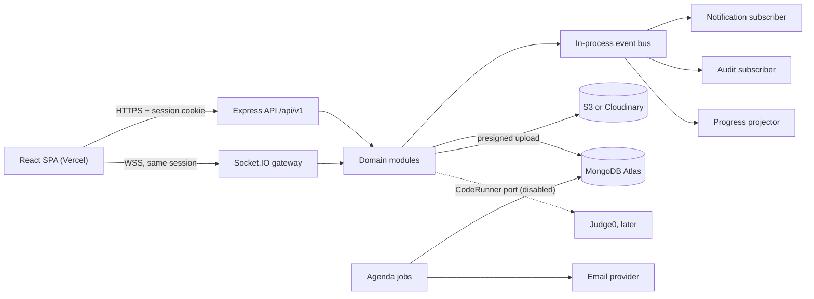
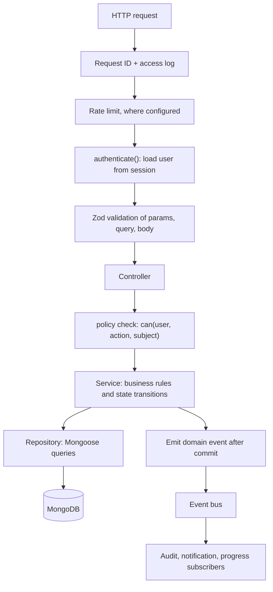
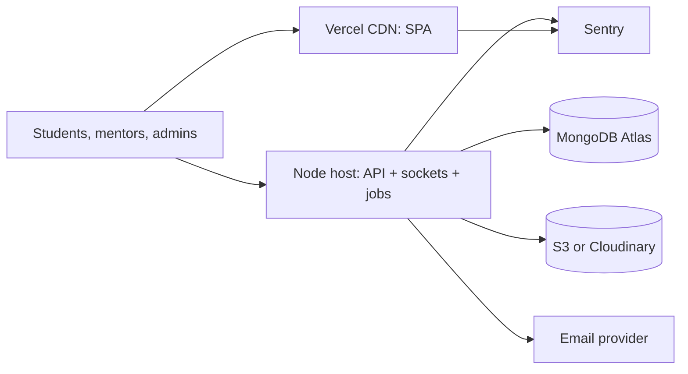

# DHRUVA — Architecture

A modular monolith. One Node.js process serves the HTTP API, the Socket.IO gateway, and the
background jobs. That is enough for about 1,000 students and 50 mentors, and every place
where the process might later be split is hidden behind an interface so the split does not
require a redesign.

## 1. System context



- The browser is a static single-page app. It holds no authority: every permission is
  re-checked on the server.
- The API and the socket gateway share one session store, so a socket connection is
  authenticated with the same cookie as an HTTP request.
- Domain modules never call each other for side effects. A module does its own work, commits
  it, and emits an event. Subscribers handle notification, audit, and progress.
- MongoDB Atlas holds all state, including job scheduling state and sessions, so there is no
  Redis and no separate broker at this scale.
- Object storage holds uploads. The API only issues presigned URLs and records the reference.
- The code-judging service is drawn dashed because it does not exist yet. The port it would
  plug into does exist (section 7).

## 2. Why a modular monolith

| Considered | Decision |
| --- | --- |
| Microservices | Rejected. At this size the operational cost exceeds the benefit, and the workflow is one transaction-heavy path that wants shared data. |
| Single unstructured Express app | Rejected. Twelve feature areas would collapse into tangled cross-calls. |
| Modular monolith | Chosen. One deployable unit, hard module boundaries, and two explicit seams for later splitting. |

The two seams, so the choice can be reversed later without a rewrite:

1. **Realtime adapter.** Socket.IO is reached through an interface. Moving to multiple
   processes means configuring the Redis adapter behind that interface and nothing else.
2. **Jobs runner.** Agenda runs in-process, but jobs are plain functions registered in one
   module. Moving them to a worker process means running that module in a second process
   against the same database.

## 3. Repository layout

An npm-workspaces monorepo:

```
dhruva/
├── client/                 React + Vite SPA
│   └── src/
│       ├── components/     shared UI primitives (shadcn/ui based)
│       ├── layouts/        student, mentor, admin shells
│       ├── features/       auth, student, mentor, admin, resources,
│       │                   assignments, assessments, discussions, notifications
│       ├── hooks/
│       ├── services/       API client, one module per feature
│       └── routes/         route table and role guards
├── server/
│   └── src/
│       ├── app.ts          express app, middleware wiring
│       ├── server.ts       http server, socket attach, graceful shutdown
│       ├── config/         env validation (fails fast on bad config)
│       ├── middleware/     auth, error handler, rate limit, request id
│       ├── modules/        one folder per domain module (section 5)
│       ├── policies/       the authorization rules (see permissions.md)
│       ├── events/         event bus and subscriber registration
│       ├── jobs/           Agenda job definitions
│       └── platform/       logging, mail, storage, clock abstractions
├── packages/
│   └── shared/             Zod schemas, enums, DTO types (section 6)
├── e2e/                    Playwright tests
└── docs/
```

`packages/shared` is the point of the monorepo. It holds the Zod schemas and the enums, and
both `client` and `server` depend on it. A field renamed in one place is a compile error in
the other, so the API contract cannot drift silently.

## 4. Request flow and module layers

Every HTTP request passes through the same pipeline:



Rules that keep the layers honest:

- Controllers are thin. They translate HTTP into a service call and a service result into an
  HTTP response. No business rules and no queries in controllers.
- Validation happens before the controller, using schemas imported from `packages/shared`.
  A request that fails validation never reaches a policy check or a service.
- Authorization happens in one place, the policy check, and services do not re-implement it.
  Services may assume the caller was authorized, but repositories enforce tenant-safety by
  taking explicit ids rather than trusting raw query input.
- Services contain the state machines and the invariants. They are the only code that writes.
- Repositories are the only code that touches Mongoose. Each repository exposes intention
  methods (`findActiveByStudent`, `addRevision`) rather than leaking query objects upward.
- Services emit events after the database write succeeds, never before, so a subscriber never
  acts on something that rolled back.

The error path is a single Express error middleware. Services throw typed domain errors
(`NotFoundError`, `ConflictError`, `ForbiddenError`, `ValidationError`), and the middleware
maps them to the standard error envelope defined in `api-documentation.md`. No handler sends
its own error shape.

## 5. Domain modules

Each module lives in `server/src/modules/<name>/` and contains `routes`, `controller`,
`service`, `repository`, and its Mongoose models. The modules are:

| Module | Responsibility |
| --- | --- |
| `auth` | Login, logout, password change, invite and reset tokens, sessions |
| `users` | Account CRUD, CSV import, activation, capability flags |
| `mentors` | Mentor assignment, reassignment, workload |
| `resources` | Resource library, versioning, visibility via `ResourceAccessService` |
| `learning-paths` | Paths, modules, weeks, days, daily plan assembly |
| `assignments` | Assignment definitions, recipient fan-out, recipient state machine |
| `submissions` | Revisions, review, rubric scoring, idempotency |
| `assessments` | Question bank, assessments, attempts, auto-grading, manual grading |
| `discussions` | Resource doubts, global forum, search, reactions, accepted answers |
| `messaging` | Conversations, messages, read state |
| `notifications` | Notification records, preferences, email dispatch |
| `moderation` | Reports, moderation actions, announcements |
| `analytics` | Dashboards, support indicators, report exports |
| `audit` | Append-only audit log and its query API |
| `settings` | Platform settings and feature flags |

Cross-module reads go through the other module's service, not its repository or model. In
practice this is rare, because most cross-module needs are expressed as events instead.

## 6. The shared package

`packages/shared` exports:

- **Enums:** `Role`, `Branch`, `UserStatus`, `Visibility`, `ResourceType`, `Difficulty`,
  `AssignmentTargetType`, `RecipientState`, `SubmissionType`, `AttemptStatus`,
  `DiscussionCategory`, `ReportStatus`, `ModerationAction`, `SupportIndicator`.
- **Zod schemas** for every request body, query string, and path parameter the API accepts,
  plus the schemas for CSV rows and for socket event payloads.
- **DTO types** inferred from those schemas, so a response type is defined once.
- **Shared constants** such as pagination limits, file type allowlists, and maximum sizes.

The server imports a schema and passes it to the validation middleware. The client imports
the same schema for react-hook-form resolvers and for parsing responses. Because the types
are inferred from the schemas, there is no separate hand-written type to go stale.

## 7. The CodeRunner port

Code execution is deliberately not built, but the seam for it is.

```ts
interface CodeRunner {
  readonly mode: "manual" | "automatic";
  run(request: RunRequest): Promise<RunResult>;
}

interface RunRequest {
  source: string;
  language: string;          // from the reserved field on the question or assignment
  tests: TestCase[];         // from the reserved testCases field
  limits: { timeMs: number; memoryMb: number };
}

interface RunResult {
  status: "passed" | "failed" | "error" | "pending_review";
  cases: { name: string; passed: boolean; message?: string }[];
}
```

- `ManualReviewRunner` is the default. `run` returns `pending_review` and does nothing else;
  the submission simply waits for a mentor, exactly as the implementation document specifies.
- The runner is injected into the submissions and assessments services, so swapping in a
  `Judge0Runner` later touches only the composition root and the new adapter.
- `language` and `testCases` are stored from day one on coding questions and coding
  assignments, so turning judging on needs no migration.
- The runner is never called unless the platform setting `codeExecution.enabled` is true,
  which ships false. While it is false, no student code is executed anywhere.

## 8. Event bus

An in-process, synchronous-dispatch bus. It is not a message broker and it does not survive
a crash; durability comes from the database, not the bus. Subscribers run after the
originating write commits, and a subscriber that fails is logged and reported but does not
fail the request. Anything that must not be lost (email, fan-out reconciliation) is also
covered by a scheduled job, so a missed event is repaired rather than fatal.

Events and their subscribers:

| Event | Raised by | Subscribers |
| --- | --- | --- |
| `user.created` | users | audit, notification (invite email) |
| `user.deactivated` | users | audit, auth (revoke sessions) |
| `user.role_changed`, `mentor.capabilities_changed` | users | audit |
| `mentor.assigned`, `mentor.reassigned` | mentors | audit, notification |
| `resource.published`, `resource.archived` | resources | audit |
| `assignment.published` | assignments | audit, notification |
| `submission.created` | submissions | notification (to mentor) |
| `submission.reviewed` | submissions | notification (to student), progress |
| `attempt.started`, `attempt.finalized` | assessments | audit (finalized), progress |
| `attempt.graded` | assessments | notification, progress |
| `doubt.replied`, `discussion.reported` | discussions | notification, moderation |
| `message.created` | messaging | notification, realtime push |
| `announcement.published` | moderation | notification |
| `moderation.action_taken` | moderation | audit, notification |
| `security.access_denied` | policies | audit |
| `security.break_glass` | messaging, users | audit, notification (to a second admin) |

The `security.access_denied` event is what makes the unauthorized-access acceptance test
observable: a mentor requesting an unassigned student's record produces an audit entry.

## 9. Background jobs

Agenda stores job state in MongoDB and runs inside the API process. Jobs are defined in
`server/src/jobs/` and are idempotent, because Agenda can retry.

| Job | Schedule | Purpose |
| --- | --- | --- |
| `assignment.reconcile_recipients` | Every 15 min | Add recipient records for students who joined a targeted cohort after publish |
| `deadline.reminders` | Hourly | Notify students with work due soon and mentors with overdue reviews |
| `announcement.publish_scheduled` | Every minute | Publish announcements whose scheduled time has arrived, expire lapsed ones |
| `attempt.expire` | Every minute | Finalize attempts whose `expiresAt` has passed but were never submitted |
| `progress.rebuild` | Nightly | Rebuild the `StudentProgress` projection from source records |
| `export.generate` | On demand | Build report exports and email a download link |
| `retention.purge` | Nightly | Apply the retention schedule to soft-deleted and expired data |
| `invite.expire` | Hourly | Expire set-password tokens past their lifetime |

## 10. Frontend architecture

- **Routing.** React Router, with one route tree per role under `/student`, `/mentor`, and
  `/admin`. A role guard reads the session from `GET /api/v1/auth/me` and redirects to the
  correct area. The guard is a convenience; the server repeats every check.
- **Server state.** TanStack Query owns all data from the API. Query keys are per resource
  and per filter. Mutations invalidate the affected keys, and socket events invalidate them
  too, so a pushed message or notification updates an open screen without a custom cache.
- **Forms.** react-hook-form with the Zod resolvers, using schemas imported from
  `packages/shared`. Client-side validation mirrors server-side validation exactly.
- **Realtime.** One socket connection per session, opened after authentication. Incoming
  events are dispatched to query invalidations and to the notification tray. The client never
  trusts a socket payload for authorization; it refetches through the API.
- **UI.** Tailwind CSS and shadcn/ui. The shared primitives are Button, Input, Select,
  Dialog, Card, Table, Badge, Dropdown, Toast, spinner, empty state, and error state.
- **Feature folders.** Each feature in `client/src/features/` holds its pages, its feature
  components, and its API hooks, so a feature maps one-to-one onto a server module.

## 11. Cross-cutting mechanisms

- **Time.** Services take a clock abstraction rather than calling `Date.now()` directly, so
  deadline and expiry logic is testable.
- **Ids.** All identifiers are MongoDB ObjectIds. They are validated as such at the boundary
  by a shared schema, so a malformed id is a 400 rather than a cast exception.
- **Concurrency.** Updates that can race use the Mongoose version key and fail with a 409 on
  conflict, which tells the client to refetch. See `api-documentation.md` for the contract.
- **Transactions.** Multi-document changes run in a MongoDB transaction: mentor
  reassignment, the CSV import commit, and the assignment publish fan-out. The transaction
  boundary is inside the service, and the event is emitted only after it commits.
- **Configuration.** Environment variables are parsed and validated with Zod at startup. A
  missing or malformed variable stops the process before it accepts traffic.

## 12. Deployment shape



One Node process per environment. Details of environments, secrets, health checks, and
scaling triggers are in `deployment.md`.
