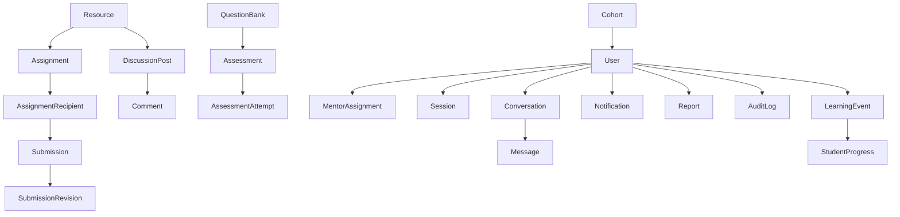
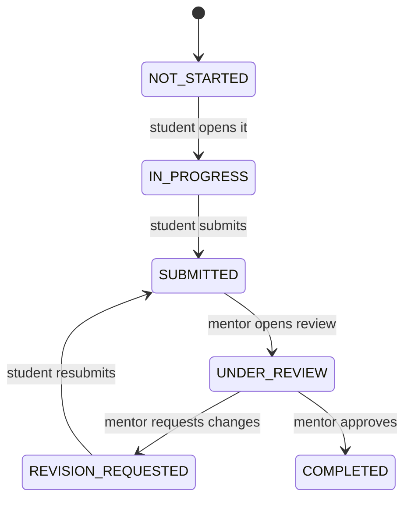
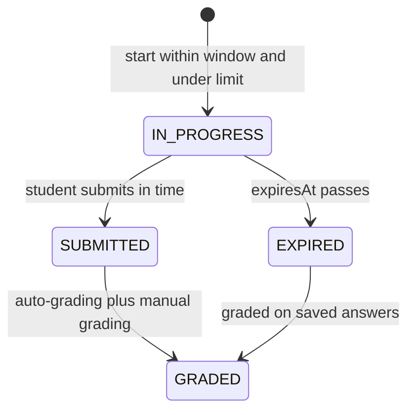

# DHRUVA — Database Design

MongoDB via Mongoose. This document lists every collection, the invariants the database
enforces, the indexes, the state machines, and where transactions are required. If a rule
here conflicts with application code, the code is wrong: these invariants are the contract.

Conventions used throughout:

- Every collection has `createdAt` and `updatedAt` unless it is append-only, in which case it
  has `createdAt` only and is never updated.
- Identifiers are ObjectIds. Cross-collection links are stored as ObjectIds with an index,
  not as embedded copies, except where a snapshot is explicitly called for.
- `versionKey` (Mongoose `__v`) is enabled on every mutable collection and is the basis for
  optimistic concurrency.
- Removals that anything else references are soft deletes: `deletedAt` is set and queries
  filter it out. Hard deletes happen only through the retention job.

## 1. Collection map

## 2. Identity and access

### 2.1 `User`

| Field | Type | Notes |
| --- | --- | --- |
| name | string | Required |
| email | string | Lowercased, unique |
| passwordHash | string | Null until the invite is accepted. Never selected by default |
| role | enum | `STUDENT`, `MENTOR`, `ADMIN` |
| branch | enum | `Branch`. Required for students, optional otherwise |
| cohortId | ObjectId | Reference to `Cohort`. Required for students |
| profileImage | string | Storage key, optional |
| status | enum | `INVITED`, `ACTIVE`, `DEACTIVATED` |
| capabilities | object | Mentor only: `canCreateResources`, `canCreateAssessments`, `canGradeAssessments`, all default false |
| invitedAt | date | When the current invite was issued |
| activatedAt | date | When the password was first set |
| deletedAt | date | Soft delete |

Indexes: unique on `email`; on `{role, status}`; on `cohortId`; on `{branch, cohortId}`.

Invariant: a `STUDENT` must have a `branch` and a `cohortId`. Enforced in the service and
with a Mongoose validator.

### 2.2 `Cohort`

Replaces the free-text cohort string in the original document.

| Field | Type | Notes |
| --- | --- | --- |
| name | string | Unique, e.g. "2026 First Year" |
| academicYear | string | e.g. "2026-27" |
| startDate, endDate | date | |
| status | enum | `UPCOMING`, `ACTIVE`, `ARCHIVED` |

### 2.3 `MentorAssignment`

| Field | Type | Notes |
| --- | --- | --- |
| mentorId | ObjectId | User with role MENTOR |
| studentId | ObjectId | User with role STUDENT |
| assignedBy | ObjectId | Admin who performed it |
| status | enum | `ACTIVE`, `ENDED` |
| startDate | date | |
| endDate | date | Null while active |
| endReason | enum | `REASSIGNED`, `COMPLETED`, `WITHDRAWN`, null |

Indexes:

- **Partial unique index** on `{studentId}` where `status = ACTIVE`. This is the guarantee
  that a student has exactly one active mentor. A second active assignment fails the write.
- On `{mentorId, status}` for the mentor's student list and workload counts.
- On `{studentId, startDate}` for history.

History is preserved by ending a record rather than editing it: reassignment sets the
current record to `ENDED` and inserts a new `ACTIVE` one, inside a transaction (section 7).

### 2.4 `Session`

Managed by connect-mongo. Holds the session id, the user id, and the expiry. All sessions
for a user are destroyed when the user is deactivated or changes their password.

### 2.5 `PasswordToken`

| Field | Type | Notes |
| --- | --- | --- |
| userId | ObjectId | |
| tokenHash | string | Only the hash is stored |
| purpose | enum | `INVITE`, `RESET` |
| expiresAt | date | Invites last 7 days, resets 1 hour |
| usedAt | date | Single use |

Index: on `tokenHash`; TTL index on `expiresAt` for cleanup, keeping used tokens until the
retention job for audit purposes.

### 2.6 `PlatformSettings`

A single document. Holds feature flags: `studentDirectMessages` (bool), `groupChat` (bool),
`codeExecution.enabled` (bool, ships false), support-indicator thresholds (section 6), and
the retention periods. Edited only by Admin, and each edit writes the previous values to the
audit log.

## 3. Learning content

### 3.1 `Resource`

| Field | Type | Notes |
| --- | --- | --- |
| title, description | string | |
| type | enum | `ARTICLE`, `VIDEO`, `PDF`, `DOCUMENTATION`, `CODING_EXERCISE`, `QUIZ`, `PROJECT`, `EXTERNAL_LINK` |
| content | string | Markdown |
| externalLink | string | Optional |
| attachments | array | `{ storageKey, fileName, mimeType, sizeBytes }` |
| topic | string | |
| tags | string[] | |
| difficulty | enum | `BEGINNER`, `INTERMEDIATE`, `ADVANCED` |
| estimatedDurationMin | number | |
| visibility | enum | `GLOBAL`, `COHORT`, `MENTOR_GROUP`, `INDIVIDUAL` |
| targetIds | ObjectId[] | Cohorts, mentors, or students, depending on visibility. Empty for GLOBAL |
| language | string | Reserved for coding exercises |
| testCases | array | Reserved: `{ name, input, expectedOutput, hidden }`. Unused until code execution is enabled |
| version | number | Starts at 1, increments on every edit after publication |
| status | enum | `DRAFT`, `PUBLISHED`, `ARCHIVED` |
| createdBy | ObjectId | |
| publishedAt | date | |

Indexes: on `{status, visibility}`; on `{topic, difficulty}`; on `createdBy`; on
`targetIds`.

Editing a published resource increments `version` in the same write. Consumers snapshot the
version they used (sections 3.5 and 4.3), so later edits never rewrite history.

### 3.2 `LearningPath`

| Field | Type | Notes |
| --- | --- | --- |
| title, description | string | |
| cohortId | ObjectId | The cohort it is built for |
| durationDays | number | |
| status | enum | `DRAFT`, `PUBLISHED`, `ARCHIVED` |
| createdBy | ObjectId | |

### 3.3 `LearningModule`, `LearningWeek`, `LearningDay`

The schedule hierarchy. A module belongs to a path, a week to a module, a day to a week.

`LearningDay` fields: `weekId`, `dayNumber`, `title`, `items`. Each item is
`{ kind, refId, required }` where `kind` is `RESOURCE`, `ASSIGNMENT`, or `ASSESSMENT`.
Days are what the student dashboard resolves into "today".

Indexes: `{pathId, order}` on modules, `{moduleId, weekNumber}` on weeks,
`{weekId, dayNumber}` on days, each unique so order cannot duplicate.

## 4. Assignments and submissions

### 4.1 `Assignment`

The definition. It carries no per-student state.

| Field | Type | Notes |
| --- | --- | --- |
| title, description | string | |
| resourceId | ObjectId | Optional |
| assignedBy | ObjectId | |
| targetType | enum | `COHORT`, `BRANCH`, `MENTOR_GROUP`, `INDIVIDUAL` |
| targetIds | ObjectId[] | Interpreted against `targetType` |
| dueDate | date | |
| priority | enum | `LOW`, `NORMAL`, `HIGH` |
| submissionType | enum | `TEXT`, `FILE`, `REPOSITORY`, `EDITOR_LINK`, `NONE` |
| language, testCases | | Reserved, as on `Resource`, for coding assignments |
| rubric | array | `{ criterion, maxPoints }` |
| status | enum | `DRAFT`, `PUBLISHED`, `ARCHIVED` |
| publishedAt | date | |

### 4.2 `AssignmentRecipient`

One record per student per assignment, created when the assignment is published. This is the
record whose state the student sees.

| Field | Type | Notes |
| --- | --- | --- |
| assignmentId | ObjectId | |
| studentId | ObjectId | |
| state | enum | See the state machine below |
| startedAt | date | First time it moved to IN_PROGRESS |
| submittedAt | date | Most recent submission time |
| completedAt | date | |
| score | number | Null until reviewed |

Indexes:

- **Unique** on `{assignmentId, studentId}`. Prevents duplicate recipients.
- On `{studentId, state}` for the student dashboard and overdue queries.
- On `{assignmentId, state}` for mentor progress views.

**Overdue is not a state.** A recipient is overdue when `dueDate` (from its assignment) is in
the past and `state` is not one of `SUBMITTED`, `UNDER_REVIEW`, or `COMPLETED`. Queries
compute this. The reminder job reads the same condition to send notifications, and it writes
nothing back to `state`.

State machine, enforced in `AssignmentService`. Any transition not drawn is rejected.

### 4.3 `SubmissionRevision`

One record per attempt, so history is never overwritten. A submission is the sequence of its
revisions.

| Field | Type | Notes |
| --- | --- | --- |
| recipientId | ObjectId | |
| studentId | ObjectId | |
| revisionNo | number | 1-based, monotonic per recipient |
| submissionType | enum | |
| textAnswer | string | |
| fileKey | string | Storage key |
| repositoryUrl | string | |
| editorUrl | string | |
| resourceVersion | number | Snapshot of the resource version submitted against |
| submittedAt | date | |
| status | enum | `PENDING`, `APPROVED`, `REVISION_REQUESTED` |
| score | number | |
| rubricScores | array | `{ criterion, points }` |
| feedback | string | |
| reviewedBy | ObjectId | |
| reviewedAt | date | |
| idempotencyKey | string | From the `Idempotency-Key` header |

Indexes: **unique** on `{recipientId, revisionNo}`; **unique** on
`{recipientId, idempotencyKey}` so a retried request returns the original revision instead of
creating another.

## 5. Assessments

### 5.1 `Question`

The question bank.

| Field | Type | Notes |
| --- | --- | --- |
| type | enum | `MCQ`, `MULTI_SELECT`, `TRUE_FALSE`, `SHORT_ANSWER`, `CODING` |
| prompt | string | Markdown |
| options | array | For objective types: `{ id, text }` |
| answerKey | object | Correct option ids or expected text. **Never serialized to students** |
| marks | number | |
| topic | string | |
| difficulty | enum | |
| language, testCases | | Reserved, for coding questions |
| createdBy | ObjectId | |

### 5.2 `Assessment`

| Field | Type | Notes |
| --- | --- | --- |
| title, description | string | |
| questionIds | ObjectId[] | Ordered |
| durationMin | number | |
| totalMarks | number | Derived from the questions |
| passingMarks | number | |
| attemptsAllowed | number | |
| availableFrom, availableUntil | date | The availability window |
| answersReleaseAt | date | When correct answers may be shown. Null means never |
| targetType, targetIds | | Same targeting model as assignments |
| status | enum | `DRAFT`, `PUBLISHED`, `ARCHIVED` |
| version | number | Incremented on edit after publish |
| createdBy | ObjectId | |

### 5.3 `AssessmentAttempt`

| Field | Type | Notes |
| --- | --- | --- |
| assessmentId | ObjectId | |
| studentId | ObjectId | |
| attemptNo | number | 1-based |
| assessmentVersion | number | Snapshot of the version taken |
| questionSnapshot | array | The questions as served, **without** answer keys |
| answers | array | `{ questionId, value, autoSavedAt }` |
| startedAt | date | Server time |
| expiresAt | date | `startedAt + duration`. The server's timer |
| submittedAt | date | |
| status | enum | `IN_PROGRESS`, `SUBMITTED`, `EXPIRED`, `GRADED` |
| autoScore | number | Objective marks, computed on finalize |
| manualScore | number | Short-answer and coding marks |
| totalScore | number | |
| gradedBy | ObjectId | |
| idempotencyKey | string | For finalization |

Indexes:

- **Unique** on `{assessmentId, studentId, attemptNo}`. Combined with the service refusing to
  start an attempt when `attemptNo` would exceed `attemptsAllowed`, this enforces the limit
  even under concurrent requests.
- On `{status, expiresAt}` for the expiry job, which finalizes attempts left open past
  `expiresAt`.

Attempt lifecycle:

Answers are upserted onto the attempt as the student works, so a lost connection loses at
most the last autosave. Grading reads the snapshot, never the live question documents, so an
edit to the bank cannot change a sitting student's paper.

## 6. Community

### 6.1 `DiscussionPost`

| Field | Type | Notes |
| --- | --- | --- |
| scope | enum | `RESOURCE`, `FORUM` |
| resourceId | ObjectId | For resource doubts |
| category | enum | Forum categories: `PROGRAMMING`, `MATHEMATICS`, `DSA`, `BRANCH`, `GENERAL`, `ANNOUNCEMENTS` |
| authorId | ObjectId | |
| title, body | string | Markdown, sanitized |
| codeSnippet | string | Optional |
| status | enum | `OPEN`, `RESOLVED` |
| acceptedCommentId | ObjectId | |
| highlighted | bool | Pinned by a mentor |
| replyCount | number | Denormalized for listing |
| deletedAt | date | Soft delete; body retained for audit until retention runs |

Indexes: on `{scope, resourceId, createdAt}`; on `{category, status, createdAt}`; and a
**text index** on `{title, body}` for keyword search.

### 6.2 `Comment`

`postId`, `parentCommentId` (null for top-level), `authorId`, `body`, `createdAt`,
`deletedAt`. Replies are one level of nesting through `parentCommentId`. Index on
`{postId, createdAt}`.

### 6.3 `Reaction`

`targetType` (`POST` or `COMMENT`), `targetId`, `userId`, `kind` (`HELPFUL` or `LIKE`),
with a unique index on `{targetType, targetId, userId, kind}` so a user reacts once.

### 6.4 `Conversation`

| Field | Type | Notes |
| --- | --- | --- |
| type | enum | `DIRECT`, `GROUP` |
| participantIds | ObjectId[] | |
| createdBy | ObjectId | |
| lastMessageAt | date | For inbox ordering |

Index: on `participantIds`; on `{participantIds, lastMessageAt}`.

Direct conversations are unique per pair. The service looks up an existing direct
conversation before creating one, and the participant check from `permissions.md` runs first.

### 6.5 `Message`

`conversationId`, `senderId`, `body`, `attachments` (storage keys), `sentAt`,
`readBy` (array of `{ userId, readAt }`), `deletedAt`. Index on
`{conversationId, sentAt}`. Messages are persisted first and pushed over the socket second;
the database is the record, the socket is only delivery.

### 6.6 `Notification`

`userId`, `type` (enum matching the events in `architecture.md`), `payload` (ids and a short
text), `readAt`, `createdAt`, `emailSentAt`. Index on `{userId, readAt, createdAt}`.

### 6.7 `Announcement`

`title`, `body`, `audience` (`ALL`, `COHORT`, `BRANCH`, `MENTOR_GROUP`), `targetIds`,
`publishAt`, `expiresAt`, `createdBy`, `status` (`SCHEDULED`, `PUBLISHED`, `EXPIRED`).
The scheduling job moves rows between statuses. Index on `{status, publishAt}`.

### 6.8 `Report`

`targetType` (`POST`, `COMMENT`, `MESSAGE`, `USER`), `targetId`, `reportedBy`, `reason`,
`status` (`OPEN`, `DISMISSED`, `ACTION_TAKEN`), `resolution` (the moderation action taken),
`resolvedBy`, `resolvedAt`. Index on `{status, createdAt}`.

## 7. Audit, analytics, and operations

### 7.1 `AuditLog` (append-only)

Administrative and security events. No updates, no deletes, ever. Not used for analytics.

| Field | Type | Notes |
| --- | --- | --- |
| actorId | ObjectId | Who did it. Null for system jobs |
| action | string | e.g. `user.created`, `security.access_denied`, `security.break_glass` |
| subjectType | string | |
| subjectId | ObjectId | |
| before | object | Previous values, for changes |
| after | object | New values |
| reason | string | Required for break-glass events |
| requestId | string | Correlates with logs |
| ip | string | |
| createdAt | date | |

Indexes: on `{subjectType, subjectId, createdAt}`; on `{actorId, createdAt}`; on
`{action, createdAt}`.

### 7.2 `LearningEvent` (append-only)

Student learning activity, kept apart from the audit log so analytics never depends on
security data and vice versa.

`studentId`, `type` (`RESOURCE_OPENED`, `ASSIGNMENT_STARTED`, `SUBMISSION_MADE`,
`ATTEMPT_STARTED`, `ATTEMPT_GRADED`, `DOUBT_ASKED`), `refType`, `refId`, `metadata`,
`occurredAt`. Index on `{studentId, occurredAt}` and `{type, occurredAt}`.

### 7.3 `StudentProgress` (a projection)

A rebuildable cache, one document per student. It exists only to make dashboards fast. It is
not a source of truth and can be dropped and rebuilt at any time.

`studentId` (unique), `assignedCount`, `completedCount`, `overdueCount`,
`completionPct`, `averageScore`, `topicScores` (array), `weeklyActiveDays`,
`supportIndicator` (`ON_TRACK`, `NEEDS_ATTENTION`, `MENTOR_INTERVENTION`), `computedAt`.

It is updated incrementally by the progress subscriber as events arrive, and rebuilt nightly
by `progress.rebuild` from `AssignmentRecipient`, `AssessmentAttempt`, and `LearningEvent`.
The nightly rebuild is authoritative: it overwrites the incremental values, so a missed
event corrects itself within a day. Indicator thresholds come from `PlatformSettings` and are
support signals only; nothing in the schema lets an indicator gate a feature or alter a score.

### 7.4 `ReportExport`

`requestedBy`, `kind`, `params`, `status` (`PENDING`, `READY`, `FAILED`), `storageKey`,
`createdAt`, `expiresAt`. Generated asynchronously by the export job.

### 7.5 `IdempotencyRecord`

For operations that are not naturally deduplicated by a unique revision index.
`key` (unique), `userId`, `requestHash`, `responseStatus`, `responseBody`, `createdAt`.
A repeat with the same key and same hash returns the stored response; the same key with a
different hash is a 409.

## 8. Transactions

MongoDB multi-document transactions are used in exactly three places. Each opens the
transaction in the service, performs all writes, commits, and only then emits its event.

| Operation | Writes inside the transaction |
| --- | --- |
| Mentor reassignment | End the current `MentorAssignment`, insert the new one, update denormalized mentor references |
| CSV import commit | Insert all validated users and their invite tokens, or none of them |
| Assignment publish fan-out | Set the assignment to `PUBLISHED` and insert all `AssignmentRecipient` rows |

The recipient fan-out is also covered by `assignment.reconcile_recipients`, which is
idempotent because of the unique `{assignmentId, studentId}` index, so a transaction that
fails partway is safely re-run.

## 9. Versioning and snapshots

| Source | Version field | Snapshotted onto |
| --- | --- | --- |
| `Resource` | `version` | `SubmissionRevision.resourceVersion` |
| `Assessment` | `version` | `AssessmentAttempt.assessmentVersion` and `questionSnapshot` |

Snapshots are taken when the student starts, not when the author edits. Grading, review, and
display of past work all read the snapshot.

## 10. Index summary

The indexes that enforce correctness rather than just speed:

| Index | Guarantees |
| --- | --- |
| `MentorAssignment {studentId}` partial, `status = ACTIVE` | One active mentor per student |
| `AssignmentRecipient {assignmentId, studentId}` unique | One recipient row per student per assignment |
| `SubmissionRevision {recipientId, revisionNo}` unique | Ordered, gap-free revision history |
| `SubmissionRevision {recipientId, idempotencyKey}` unique | No duplicate submissions on retry |
| `AssessmentAttempt {assessmentId, studentId, attemptNo}` unique | Attempt limit holds under concurrency |
| `Reaction {targetType, targetId, userId, kind}` unique | One reaction of each kind per user |
| `DiscussionPost {title, body}` text | Keyword search |
| `User {email}` unique | One account per email address |
