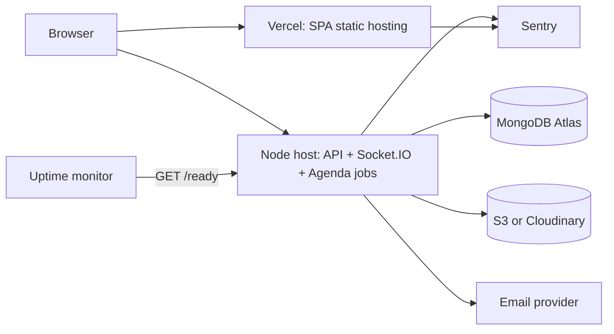

# DHRUVA — Deployment

How the platform is hosted, promoted between environments, and operated. The accountability
for each runbook is assigned in `roles-and-responsibilities.md` section 4.

## 1. Topology

One Node process serves the API, the websocket gateway, and the background jobs. That is the
whole production footprint at the target size. The seams for splitting it are described in
`architecture.md` and are not needed now.

## 2. Environments

| | Local | Staging | Production |
| --- | --- | --- | --- |
| Frontend | Vite dev server | Vercel preview | Vercel production |
| API | localhost | Node host, staging app | Node host, production app |
| Database | Local MongoDB or Atlas dev tier | Atlas, staging cluster | Atlas, dedicated cluster |
| Object storage | Separate dev bucket | Staging bucket | Production bucket |
| Email | Captured locally, not sent | Sent to an allowlist only | Sent for real |
| Jobs | Agenda, running | Agenda, running | Agenda, running |
| Data | Seed script | Anonymized sample cohort | Real cohort |

Staging is a full copy of the production topology, not a reduced one, so socket behaviour,
jobs, and email templates are exercised before release. Staging email is restricted to an
allowlist so a test cannot email real students.

## 3. Configuration and secrets

All configuration comes from environment variables, validated with a Zod schema at startup.
The process refuses to boot if any are missing or malformed.

| Variable | Purpose |
| --- | --- |
| `NODE_ENV` | environment |
| `PORT` | API port |
| `MONGODB_URI` | database connection |
| `SESSION_SECRET` | session signing |
| `CSRF_SECRET` | CSRF token signing |
| `CLIENT_ORIGIN` | the one allowed CORS origin |
| `STORAGE_BUCKET`, `STORAGE_KEY`, `STORAGE_SECRET` | object storage |
| `EMAIL_API_KEY`, `EMAIL_FROM` | email provider |
| `SENTRY_DSN` | error reporting |
| `APP_BASE_URL` | links inside emails |

Secrets live in the host's secret store and in Vercel's environment settings. They are not
committed. Each environment has its own values, and production secrets are distinct from
staging. Rotation of `SESSION_SECRET` logs everyone out, so it is done in a maintenance
window and noted in the audit log.

## 4. CI pipeline

GitHub Actions, on every pull request and on every merge to the main branch:

1. Install with `npm ci` from the lockfile.
2. Type-check and lint the whole workspace.
3. Unit tests: Vitest for the client and for server domain logic, including the pure policy
   functions.
4. API tests: Supertest against an ephemeral MongoDB, including the permission matrix that
   asserts every role against every endpoint.
5. Build the client and the server.
6. End-to-end tests: Playwright against the built app, including both acceptance scenarios
   from the implementation document.
7. On failure, the merge is blocked. On success on the main branch, the pipeline deploys.

A pull request cannot be merged with a failing matrix or a failing acceptance test. That is
the mechanism behind "test permissions continuously".

## 5. Release and rollout

1. Merge to main deploys the client to Vercel and the server to the Node host.
2. Database changes are backward compatible with the currently running version, because the
   deploy is not instantaneous. Additive changes (new fields, new indexes) go out first;
   removals wait until the next release.
3. Indexes are built in the background before the code that depends on them is deployed.
4. After deploy, the pipeline checks `/ready` and runs the smoke test: login as each role and
   load each dashboard.
5. If the smoke test fails, the previous release is redeployed. Because releases are backward
   compatible, rolling back the code does not require rolling back the database.

### 5.1 When to scale beyond one process

Revisit the topology only if one of these happens: CPU stays above 70 percent during a
scheduled assessment, socket connections exceed what one process comfortably holds, or job
runs start delaying request latency. The first move is to run the jobs module in a separate
process against the same database. The second is to add the Socket.IO Redis adapter. Neither
changes application code beyond configuration, because both sit behind the interfaces in
`architecture.md`.

## 6. Runbooks

### 6.1 Backup and monthly restore drill

Owner: platform operator.

1. Confirm in the Atlas console that continuous backup is enabled and the last snapshot is
   under 24 hours old. Do this weekly.
2. Monthly, restore the latest snapshot into a scratch cluster.
3. Point a local copy of the app at the scratch cluster and run the smoke tests.
4. Record the date, the restore duration, and the result in the operations log.
5. Drop the scratch cluster. If the restore failed, raise it as an incident the same day.

### 6.2 Incident response

Owner: platform operator, with a named deputy.

1. Detect: the uptime alert on `/ready`, a Sentry spike, or a user report.
2. Triage: read the request ids around the failure, check `/ready`, the Atlas status, and the
   job queue. Decide whether it is the app, the database, storage, or email.
3. Mitigate: roll back the release if a deploy caused it, or failover using the point-in-time
   restore if data was lost. The targets are in `reliability-and-security.md` section 7.
4. Communicate: tell the program coordinator, who tells affected mentors and students.
5. Resolve and review: write down what happened, the timeline, and what changes, and file the
   follow-up work. Review it within a week.

Severity guide: the platform is down or grades are affected (high, respond immediately), a
feature is impaired but learning continues (medium, respond the same day), cosmetic or a
single user (low, schedule it).

### 6.3 Mentor training

Owner: program coordinator.

Before a cohort starts, and whenever a mentor is added:

1. Issue the mentor's account through the invite flow and confirm they activate it.
2. Walk through the mentor dashboard, reviewing a submission, requesting a revision, answering
   a doubt, and reading a support indicator — including what an indicator does *not* do.
3. Explain the scope of their access: only assigned students, and why requesting anything else
   is denied and logged.
4. Set capability flags only for mentors who will actually create content, and record why.

### 6.4 CSV import of a cohort

Owner: program coordinator.

1. Collect the cohort file with the columns Name, Email, Branch, Cohort, Role. Branch and
   cohort values must match the platform's enums and existing cohort records.
2. Upload and read the validation report. Fix rejected rows in the source file rather than
   editing around them.
3. Confirm the preview. The commit is transactional, so it either creates all valid users or
   none.
4. Verify the import result report: created count, skipped rows, and that invite emails were
   queued.
5. A week later, reinvite anyone still in `INVITED` status.

### 6.5 Data-retention review

Owner: platform operator. Cadence: quarterly.

1. Confirm the retention job has run nightly since the last review, from its logs.
2. Check the counts it deleted against the schedule in `reliability-and-security.md`.
3. Review every break-glass audit entry since the last review and confirm each had a
   justified reason. Raise an incident for any that did not.
4. Confirm backups are expiring on schedule and no export files older than their link
   lifetime remain.
5. Record the review.

### 6.6 Support-indicator threshold review

Owner: program coordinator. Cadence: once per cohort, before it starts.

1. Review the thresholds in platform settings against last cohort's distribution, so the
   flags highlight students who need help rather than most of the cohort.
2. Adjust, which is audited automatically.
3. Remind mentors that indicators are support signals and never affect grades or access.

### 6.7 Dependency and security updates

Owner: platform operator.

1. Monthly, review Dependabot pull requests, merge the low-risk ones, and schedule the rest.
2. For a critical advisory, patch within 7 days: update, run the full CI pipeline, deploy.
3. Record what was updated and when.

## 7. Pilot and launch

Carried over from the implementation document, with the operational owners added.

1. Pilot with 2 mentors and 10 to 15 students on a 7-day plan. Both acceptance tests must be
   passing in CI before the pilot opens.
2. Watch the full cycle: assignment, submission, feedback, doubt, progress. The platform
   operator checks errors and job health daily during the pilot.
3. Fix what the pilot surfaces, then import the full cohort using runbook 6.4, allocate
   mentors, publish the schedule, train the mentors using runbook 6.3, and send students their
   invite instructions.
4. The program starts only after the pilot feedback has been addressed and the restore drill
   has been run at least once.

## 8. Operations log

Keep one running log, dated, of restore drills, incidents, retention reviews, threshold
changes, and dependency updates. It is the evidence that the runbooks above actually happen,
and it is the first thing reviewed when something goes wrong.
