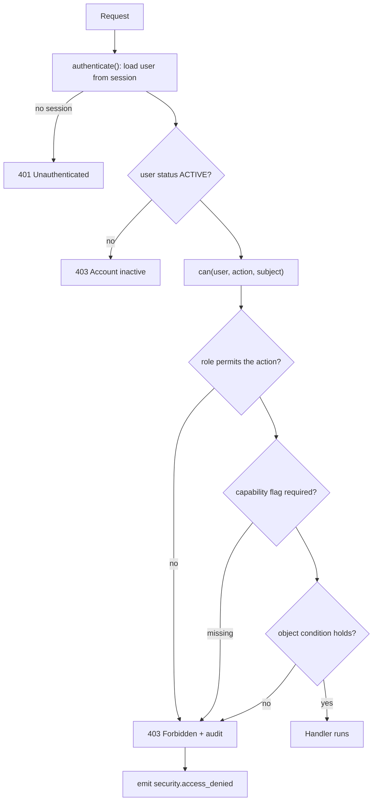

# DHRUVA — Permissions

Authorization is role-based access control plus object-level conditions. A role grants a
baseline; the object decides the rest. A mentor's role allows "review submission", but only
the object check — is this student assigned to this mentor right now — allows the specific
request. Both halves are evaluated on the server for every request.

Frontend route guards are not part of the security model. They only stop a user from seeing
a page they cannot use.

## 1. How a request is authorized

- `authenticate()` resolves the session to a user and rejects inactive accounts. It is
  applied to every route except login, password reset, the invite acceptance endpoints, and
  the health endpoints.
- `authorize(action, loadSubject)` is the middleware. It loads the subject (the specific
  student, submission, resource, or conversation) and calls `can(user, action, subject)` in
  the central `policies/` module. If `can` returns false it responds 403 and emits
  `security.access_denied`, which the audit subscriber records.
- Policies are plain functions of `(user, subject) → boolean`. They are pure and unit tested
  on their own, separate from the HTTP layer. Adding a rule means editing one function, not
  scattering conditions through controllers.

### 1.1 The assigned-student check

The most important object condition is "this mentor is responsible for this student". It is
true only when an `MentorAssignment` exists with this `mentorId`, this `studentId`, and
status `ACTIVE`. The check is done by one function, `isAssignedMentor(mentorId, studentId)`,
whose result is cached for the lifetime of the request, so a handler that touches several of
a student's records pays for it once. The cache never outlives the request, so a reassignment
takes effect on the very next request.

Admin passes this check for every student. A student passes it only for their own id.

## 2. Resource visibility

`ResourceAccessService` is the single place that decides whether a user may see a resource.
It is used by the resource list, the resource detail page, attachment download URLs, the
daily plan, and any socket payload that carries resource content. There is no second copy of
this logic anywhere.

A student can see a resource when any one of these holds:

1. `visibility = GLOBAL` and the resource is published.
2. `visibility = COHORT` and the student's cohort is in the resource's target list.
3. `visibility = MENTOR_GROUP` and the student's active mentor is in the resource's target list.
4. `visibility = INDIVIDUAL` and the student is in the resource's target list.
5. The student is an `AssignmentRecipient` of an assignment whose resource is this one.
   Being assigned the work grants access to the material, even if the resource's own scope
   would not.

Additionally the resource must not be archived, unless the caller is Admin or its author.

A mentor sees a resource they authored, a resource published to a scope they belong to, and
every resource assigned to one of their students. Admin sees all resources in every state.

Download links are short-lived signed URLs minted only after this check passes. A URL that
leaks expires quickly and was only ever issued to someone entitled to it.

## 3. The permission matrix

"Own" means the record belongs to the calling user. "Assigned" means `isAssignedMentor`
holds. "Flag" names a capability flag from `roles-and-responsibilities.md` that must also be
set. A dash means denied.

### 3.1 Accounts and session

| Action | Student | Mentor | Admin |
| --- | --- | --- | --- |
| View own profile | Own | Own | Own |
| Edit own profile and notification preferences | Own | Own | Own |
| Change own password | Own | Own | Own |
| View another user's profile | — | Assigned students | All |
| Create user (single or CSV) | — | — | Yes |
| Edit user details, branch, cohort | — | — | Yes |
| Set mentor capability flags | — | — | Yes |
| Deactivate or reactivate account | — | — | Yes |
| Reissue a password invite | — | — | Yes |
| Export a user's personal data | — | — | Break-glass only |

### 3.2 Mentor allocation

| Action | Student | Mentor | Admin |
| --- | --- | --- | --- |
| View a student's mentor | Own | Assigned | All |
| Assign students to a mentor | — | — | Yes |
| Reassign a student | — | — | Yes |
| View mentor workload | — | Own workload | All |
| View assignment history | — | — | Yes |

### 3.3 Resources

| Action | Student | Mentor | Admin |
| --- | --- | --- | --- |
| List and view resources | Per section 2 | Per section 2 | All |
| Create or edit a resource | — | Flag `canCreateResources` | Yes |
| Publish to MENTOR_GROUP or INDIVIDUAL | — | Flag `canCreateResources`, own students only | Yes |
| Publish to COHORT or GLOBAL | — | — | Yes |
| Archive a resource | — | Own authored, with flag | Yes |
| Upload an attachment | — | With `canCreateResources` | Yes |

### 3.4 Learning paths and assignments

| Action | Student | Mentor | Admin |
| --- | --- | --- | --- |
| View own daily plan and assignments | Own | — | — |
| View a student's plan and assignments | — | Assigned | All |
| Create a learning path | — | — | Yes |
| Create an assignment | — | For assigned students only | Any target |
| Publish an assignment | — | Own assignments, assigned targets | Yes |
| Change a recipient's state by submitting | Own recipient | — | — |

### 3.5 Submissions

| Action | Student | Mentor | Admin |
| --- | --- | --- | --- |
| Create a submission or revision | Own recipient, while open | — | — |
| View a submission and its history | Own | Assigned student | All |
| Approve, request revision, comment | — | Assigned student | All |
| Score and apply a rubric | — | Assigned student | All |

### 3.6 Assessments

| Action | Student | Mentor | Admin |
| --- | --- | --- | --- |
| View published assessments available to self | Targeted to self | — | All, any state |
| Create or edit an assessment or question | — | Flag `canCreateAssessments` | Yes |
| Publish an assessment to a cohort or globally | — | — | Yes |
| Start an attempt | Within window and attempt limit | — | — |
| View own attempt and score | Own, answers released per policy | — | — |
| View a student's attempt | — | Assigned, no answer key | All |
| Manually grade an answer | — | Flag `canGradeAssessments`, assigned student | Yes |
| View assessment analytics | — | Assigned students only | All |

Answer keys and per-question correct answers are excluded from every payload to a student,
and from mentor payloads, until the assessment's configured release time. This is a
serialization rule in the assessments service, not a UI choice.

### 3.7 Discussions

| Action | Student | Mentor | Admin |
| --- | --- | --- | --- |
| Read a resource doubt thread | If the resource is visible | If the resource is visible | All |
| Post a doubt, comment, or reply | On visible resources and in forum | Yes | Yes |
| Mark an answer accepted | Own doubt only | Yes | Yes |
| Mark helpful, react | Yes | Yes | Yes |
| Mark a doubt resolved, highlight, escalate | — | Yes | Yes |
| Report content | Yes | Yes | Yes |

### 3.8 Messaging

| Action | Student | Mentor | Admin |
| --- | --- | --- | --- |
| Message own mentor | Yes | — | — |
| Message an assigned student | — | Yes | — |
| Message another student | Only if `settings.studentDirectMessages` is on | — | — |
| Create or join a group chat | Only if `settings.groupChat` is on | Only if enabled | — |
| Read a conversation | Participants only | Participants only | Break-glass only |
| Read reported message content | — | — | The reported message only |

A conversation can only be created between participants the rules above allow. The check
runs on creation and again on every read and every socket join, so a student who is
reassigned loses access to the old mentor conversation for new messages while history
remains with the participants.

### 3.9 Notifications, announcements, analytics

| Action | Student | Mentor | Admin |
| --- | --- | --- | --- |
| Read and dismiss notifications | Own | Own | Own |
| Create an announcement | — | — | Yes |
| Read announcements | Targeted to self | Targeted to self | All |
| View analytics | Own progress | Assigned students | All |
| Export reports | — | — | Yes |
| Edit platform settings | — | — | Yes |

### 3.10 Moderation and audit

| Action | Student | Mentor | Admin |
| --- | --- | --- | --- |
| File a report | Yes | Yes | Yes |
| List and act on reports | — | — | Yes |
| Warn or suspend a user | — | — | Yes |
| Read the audit log | — | — | Yes |
| Edit or delete an audit entry | — | — | Never |

## 4. Denial behaviour

- Missing or invalid session: `401` with the standard error envelope.
- Authenticated but not permitted, including a failed object check: `403`, and a
  `security.access_denied` audit event recording the user, the action, the subject type and
  id, and the request id. The response body does not reveal whether the subject exists.
- Subject does not exist: `404`, but only after the caller would have been allowed to see it.
  For subjects the caller could not see anyway, the response is `403`. This stops callers
  from probing for the existence of other students' records.

## 5. Socket authorization

Socket events are authorized with the same policies as HTTP. The connection itself is
authenticated from the session cookie during the handshake, and rejected if the user is
inactive. Each incoming event names an action and a subject, and the handler calls `can`
before doing anything. Room membership (a conversation room, a notification room) is granted
only after the same check that guards the corresponding HTTP read, and it is re-checked when
the connection subscribes, not only when it first connects.

## 6. Testing the matrix

Every row in section 3 becomes rows in a Supertest permission matrix that runs in CI: for
each endpoint, one request per role, asserting the expected status. Object conditions get
their own cases — the assigned mentor is allowed, a different mentor is denied and produces
an audit entry, the student who owns the record is allowed, a different student is denied.
This matrix is the guard against regressions in the rules above, and it is extended in the
same pull request whenever an endpoint or a rule is added. The approach is described in
`implementation-roadmap.md`.
