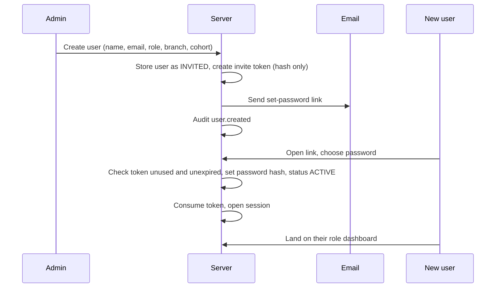
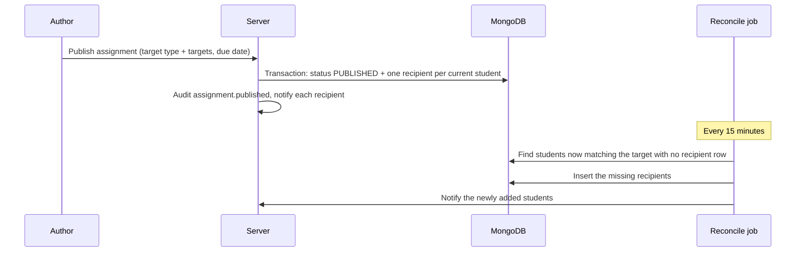
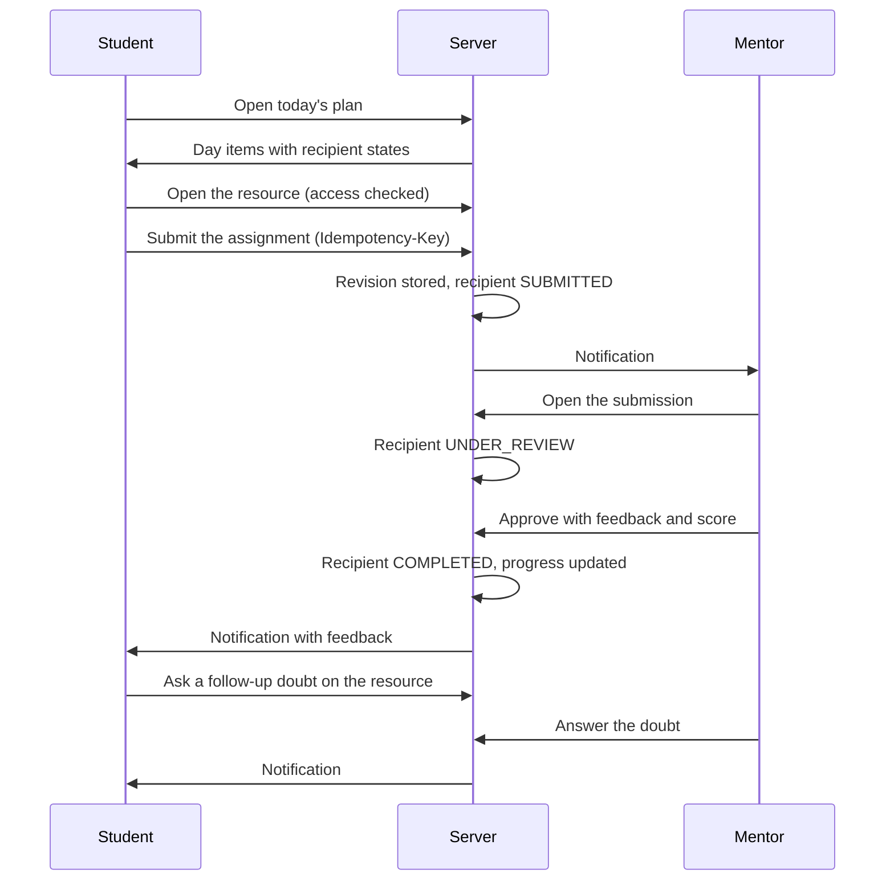
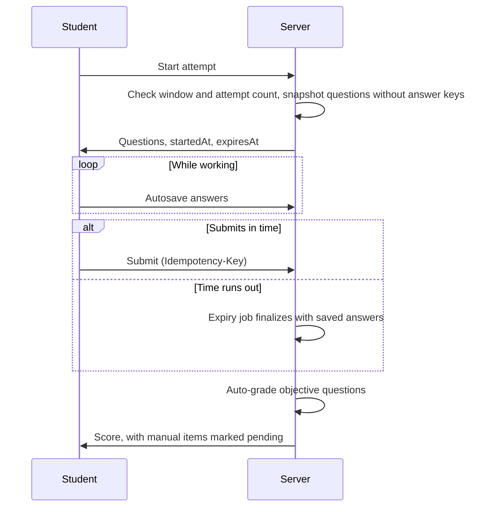
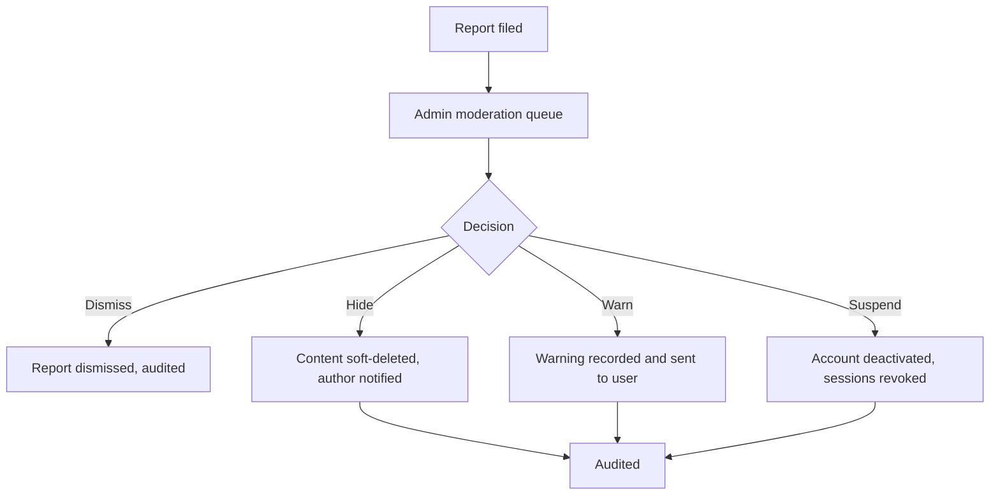

# DHRUVA — Workflows

The end-to-end journeys through the platform. Each workflow names the actor, the steps, and
what the system records. The state names and endpoint behaviour referenced here are defined
in `database-design.md` and `api-documentation.md`.

## 1. Onboarding by invite

Admin never chooses or sees a password.

1. Admin creates the user singly or includes them in a CSV import. The create request has no
   password field; the API rejects one if it is sent.
2. The user is stored with status `INVITED` and a `PasswordToken` of purpose `INVITE`,
   valid for 7 days. Only the token's hash is stored.
3. The email carries a single-use link. The audit log records the creation.
4. The user sets a password. The server checks the token, stores the password hash, flips the
   status to `ACTIVE`, marks the token used, and starts a session.
5. An expired or used link fails with a message telling the user to ask Admin for a new one.
   Admin reissues it through the reinvite action, which invalidates the previous token.
6. A user who never accepts the invite cannot log in, and appears as `INVITED` in the user
   list so Admin can see who still needs chasing.

CSV import adds a preview step. Admin uploads the file, the server validates every row
(required fields, branch and cohort against known values, duplicate emails both within the
file and against existing users), and returns a report. Nothing is written yet. Admin
confirms, and the commit creates every valid user inside one transaction and sends the
invites. Invalid rows are reported and skipped, never partially applied.

## 2. Mentor allocation and reassignment

1. Admin opens a mentor, sees current workload, and selects students who have no active
   mentor or whom they intend to move.
2. On assignment, the server inserts one `ACTIVE` `MentorAssignment` per student. The partial
   unique index rejects a second active mentor, so the "one mentor" rule holds even if two
   admins assign the same student at once. The losing request returns a conflict and the
   admin refetches.
3. On reassignment, inside one transaction, the current assignment is set to `ENDED` with
   reason `REASSIGNED` and an end date, and a new `ACTIVE` assignment is inserted.
4. Both the student and both mentors receive a notification, and the change is audited with
   the before and after mentor.
5. The new mentor sees the student on their next request. The previous mentor loses access on
   their next request, because the assigned-student check reads current `ACTIVE` records and
   its cache lasts only one request. History remains queryable by Admin.

## 3. Publishing a resource

1. An author (Admin, or a mentor with `canCreateResources`) creates a draft with its type,
   content, topic, difficulty, and attachments.
2. Attachments are uploaded directly to object storage with a presigned URL, then linked by
   storage key once the server has confirmed the object exists.
3. Publishing sets the visibility scope and its targets. A mentor can publish only to their
   own mentor group or to individual students assigned to them; cohort-wide and global
   publishing is Admin only, and the API enforces it.
4. The resource becomes visible immediately to everyone the scope covers, through the same
   access service that guards lists, detail pages, and download links.
5. A later edit increments `version`. Work already submitted against an earlier version keeps
   its snapshot, so the author can improve a resource without rewriting history.

## 4. Assignment fan-out

1. The author defines the assignment: what is being asked, the optional resource, the
   submission type, the due date, the priority, and the target. A mentor's targets are
   restricted to their assigned students.
2. Publishing resolves the target to a concrete student list at that moment — a whole cohort,
   selected branches within a cohort, a mentor's current students, or named individuals — and
   writes one `AssignmentRecipient` per student in state `NOT_STARTED`, in the same
   transaction that marks the assignment published.
3. Each recipient is notified.
4. Students who join a targeted cohort later are not visible to that transaction, so
   `assignment.reconcile_recipients` runs every fifteen minutes, finds students who match a
   published assignment's target but have no recipient row, and inserts them. The unique
   index makes this safe to run repeatedly.
5. From then on, all per-student state lives on the recipient. The assignment definition is
   not modified as students progress.

## 5. A student completes a learning activity

This is the core workflow and the basis of acceptance test 1.

1. The student signs in and lands on the dashboard. Today's plan is assembled from the
   learning path's day items plus any individually assigned work, each with its recipient state.
2. The student opens the resource. The access service checks visibility, and the open is
   recorded as a learning event.
3. The student starts the assignment (recipient moves to `IN_PROGRESS`) and submits text, a
   file, a repository URL, or an editor link. The submission carries an idempotency key, so a
   double click creates one revision, not two. The recipient moves to `SUBMITTED` and the
   revision records the resource version it was written against.
4. The mentor is notified, opens the submission (recipient moves to `UNDER_REVIEW`), and
   either approves it with feedback and a score or requests a revision.
5. On approval the recipient moves to `COMPLETED` and the progress projection updates. On a
   revision request it moves to `REVISION_REQUESTED`; the student's resubmission creates a new
   revision and returns the recipient to `SUBMITTED`. Earlier revisions stay readable.
6. The student reads the feedback and can ask a doubt on the resource. The mentor answers,
   and the student is notified.
7. The student's dashboard and the admin analytics both reflect the completion, because both
   read from the same recipient and progress records. Admin can also open the activity history
   for the student and see the learning events.

## 6. Overdue work

Nothing changes a recipient's state when a deadline passes. When the due date is past and the
recipient is not `SUBMITTED`, `UNDER_REVIEW`, or `COMPLETED`, every read reports it as
overdue. The hourly reminder job finds the same rows and sends a notification to the student,
and a digest to the mentor, without writing to the recipient. A late submission is still
accepted unless the assignment was archived; it is simply marked overdue in the history.

## 7. Taking an assessment

1. The student opens an assessment targeted at them within its availability window and sees
   the instructions, duration, and attempts remaining.
2. Starting an attempt checks the window and the attempt count, then snapshots the questions
   onto the attempt **without answer keys**, and sets `expiresAt` from the server clock. The
   unique index on attempt number means two simultaneous starts cannot create two attempts.
3. The client shows a countdown derived from `expiresAt`, but the server decides. Answers are
   autosaved continuously.
4. Submitting finalizes the attempt and auto-grades the objective questions. If the student
   never submits, the expiry job finalizes it at `expiresAt` using the last saved answers.
   Either way the result is one attempt with one score.
5. Short-answer and coding questions wait for manual grading by Admin or by a mentor with
   `canGradeAssessments` who is assigned to that student. Once graded, the total is computed
   and the student is notified.
6. Correct answers are withheld until the assessment's `answersReleaseAt`. Before that, no
   endpoint returns them to a student or a mentor.
7. A student who has used every attempt is refused with an unprocessable response, and the
   interface shows that no attempts remain.

## 8. Doubts and the forum

1. On any resource the student can see, they open the doubt section and post a question,
   optionally with a code snippet. Other students reply, and replies can be nested one level.
2. The mentor responsible for that student is notified, answers, and can mark the answer
   accepted, mark the thread resolved, or highlight it for everyone.
3. In the global forum, posts belong to a category. Anyone authenticated can read and post.
   Search runs over the text index, and the list can be filtered to unanswered or resolved.
4. A mentor who cannot resolve a problem escalates it, which files a report for Admin.
5. Anyone can report a post, comment, or user. Reports feed the moderation queue.

## 9. Messaging

1. A student opens a conversation with their assigned mentor. The server finds the existing
   direct conversation or creates one, after checking the pair is allowed.
2. Student-to-student conversations are created only when `studentDirectMessages` is enabled,
   and group conversations only when `groupChat` is enabled. Both default off, so a fresh
   deployment has mentor communication only.
3. A message is written to the database first, then pushed to participants who have the
   conversation open, and a notification is created for those who do not.
4. Read receipts are recorded per participant. Typing indicators are relayed but not stored.
5. When a student is reassigned, the conversation with the previous mentor remains readable by
   its original participants but the previous mentor can no longer see the student's other
   private records.

## 10. Moderation

1. Reports arrive from the forum, from resource doubts, and from message reports.
2. Admin reviews the queue. For a reported message, Admin sees the reported message itself,
   which the reporting user has already brought to Admin's attention. Opening the surrounding
   private conversation requires the break-glass step below.
3. Admin chooses one action. Hiding content soft-deletes it. Suspending a user deactivates the
   account and revokes sessions immediately.
4. Every resolution is audited with the action, the note, and the actor, and the affected user
   is notified of a warning or suspension.

## 11. Break-glass access to a private conversation

Used only when moderation cannot be decided from the reported message alone.

1. Admin opens the conversation through the break-glass action and must enter a reason. The
   request is rejected without one.
2. The server writes a `security.break_glass` audit entry containing the admin, the
   conversation, the reason, and the request id, then returns the messages.
3. A second admin is notified that the access happened, so no single admin can read private
   messages silently.
4. The access is visible in the audit viewer and is part of the quarterly retention review.

## 12. Announcements

1. Admin writes an announcement, picks an audience (everyone, cohorts, branches, or mentor
   groups), and either publishes now or sets a `publishAt`.
2. The scheduling job publishes it when its time arrives and expires it after `expiresAt`.
3. Targeted users see it in their announcement list and receive a notification.

## 13. Progress, support indicators, and exports

1. As students work, learning events and the progress subscriber keep each student's
   projection current: completion, scores, topic breakdown, and weekly activity.
2. The support indicator is recomputed from the thresholds in platform settings. It is shown
   to mentors and admins as a support signal with the reason visible, and it changes nothing
   about what the student can do or how they are graded.
3. Nightly, the projection is rebuilt from source records, correcting anything an event missed.
4. Admin requests an export, which runs as a job and produces a file with a short-lived
   download link. Exports cover student progress, mentor allocation, assessments, and cohort
   performance.

## 14. Unauthorized access (acceptance test 2)

1. Mentor A is assigned Student A. Mentor B is assigned Student B.
2. Mentor B requests Student A's profile, assignments, submissions, or progress.
3. The policy check finds no `ACTIVE` assignment between Mentor B and Student A and denies the
   request with 403.
4. The denial emits `security.access_denied`, which is written to the audit log with the
   actor, the subject, and the request id.
5. The response does not reveal whether Student A exists. This scenario is automated as an
   end-to-end test.
